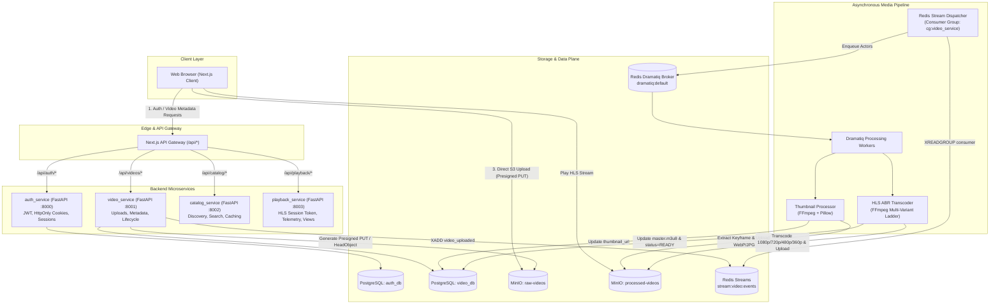
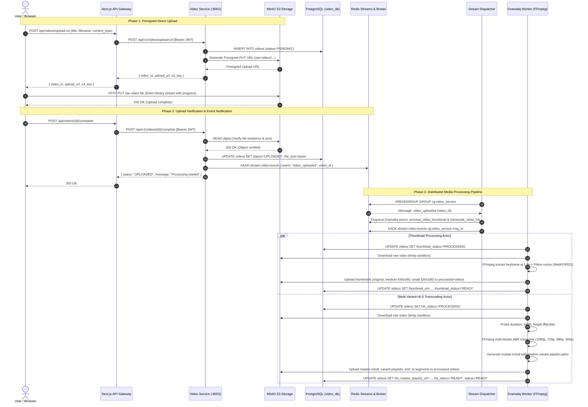

# Distributed Video Streaming Platform

A microservices-based distributed video streaming platform designed for educational and learning purposes. This project demonstrates direct-to-storage video ingestion, asynchronous media processing pipelines (Dramatiq + Redis Streams), multi-bitrate HLS adaptive streaming, catalog management, and observability across independent services.

> [!NOTE]
> This repository is created for educational and personal learning purposes.

---

## Architecture Overview

The platform employs a decoupled microservices architecture with direct-to-object-storage uploads, event-driven background processing, and adaptive bitrate delivery:



---

## End-to-End Video Ingestion & Processing Flow

The platform decouples high-bandwidth media ingestion from service instances by utilizing **S3 Presigned PUT URLs**, event streaming with **Redis Streams**, and distributed task queues via **Dramatiq**:



---

## HLS Transcoding & Media Specifications

The video processing pipeline automatically generates an **Adaptive Bitrate (ABR)** ladder using FFmpeg and segments media into HLS format:

| Variant | Resolution | Video Bitrate | Audio Bitrate | Target Frame Rate |
| :--- | :--- | :--- | :--- | :--- |
| **1080p (Full HD)** | 1920 &times; 1080 | 5000 kbps | 192 kbps | 30 fps |
| **720p (HD)** | 1280 &times; 720 | 2800 kbps | 128 kbps | 30 fps |
| **480p (SD)** | 854 &times; 480 | 1400 kbps | 128 kbps | 30 fps |
| **360p (Low)** | 640 &times; 360 | 800 kbps | 96 kbps | 30 fps |

- **Segment Duration**: 6 seconds per segment (`.ts`).
- **Master Playlist (`master.m3u8`)**: Uses relative paths (`1080p/index.m3u8`, `720p/index.m3u8`), ensuring portability across S3 buckets and CDNs without hardcoded domain dependencies.
- **Thumbnails**: Multi-resolution image bundle (`original.webp`, `medium.webp`, `small.webp`, and `.jpg` fallbacks) generated via FFmpeg keyframe capture and Pillow Lanczos resampling.

---

## Repository Structure

```text
distributed-video-streaming-platform/
├── infra/                      # Docker Compose & local infrastructure configs
│   ├── docker-compose.yml      # MinIO, PostgreSQL, Valkey/Redis, Loki, Grafana
│   └── .env.example
├── services/
│   ├── auth_service/           # FastAPI Authentication & User Management
│   │   ├── app/                # JWT tokens, HttpOnly cookies, session management
│   │   └── tests/              # 20 unit and integration tests
│   ├── video_service/          # FastAPI Video Ingestion & Processing Pipeline
│   │   ├── app/
│   │   │   ├── api/            # Presigned URL generation & completion endpoints
│   │   │   ├── core/           # S3, Redis, PostgreSQL connectors & config
│   │   │   ├── repository/     # Asynchronous database queries
│   │   │   ├── services/       # Video upload business logic & S3 verification
│   │   │   └── workers/        # Dramatiq actors, Redis stream dispatcher, FFmpeg
│   │   └── tests/              # 13 unit and pipeline integration tests
│   ├── catalog_service/        # FastAPI Video Catalog & Discovery Service (:8002)
│   │   ├── app/                # Catalog queries, search, and Redis caching
│   │   └── tests/              # 7 unit and integration tests
│   └── playback_service/       # FastAPI Playback Session & Streaming Service (:8003)
│       ├── app/                # HLS manifest resolution, heartbeat, and view counters
│       └── tests/              # 8 unit and integration tests
└── webapp/                     # Next.js 16 (React 19, Tailwind CSS)
    ├── app/
    │   ├── api/auth/           # API Gateway routes for authentication
    │   └── api/videos/         # API Gateway routes for presigned uploads & status
    ├── components/
    │   ├── AuthModal.tsx       # Sign in / Sign up interactive modal
    │   ├── Navbar.tsx          # Navigation, search bar, user menu, and upload CTA
    │   └── UploadModal.tsx     # Drag-and-drop video upload with XHR progress
    └── lib/                    # Client APIs, auth context, and server helpers
```

---

## Tech Stack

- **Frontend & Gateway**: Next.js 16 (App Router), React 19, Tailwind CSS, Lucide Icons
- **Backend Microservices**: Python 3.12, FastAPI, Asyncpg, Pydantic v2, uv
- **Media Engine**: FFmpeg, FFprobe, Pillow (PIL)
- **Task Queue & Event Bus**: Dramatiq, Redis Streams, Valkey / Redis
- **Storage & Databases**: MinIO (S3-compatible distributed object store), PostgreSQL
- **Observability**: Grafana, Loki, Promtail
- **Tooling**: Docker Compose, Ruff, Pytest, Pytest-Asyncio

---

## Getting Started

### 1. Prerequisites

- [Docker](https://docs.docker.com/get-docker/) & Docker Compose
- [uv](https://docs.astral.sh/uv/) (Fast Python package manager)
- [Node.js](https://nodejs.org/) (v18+) & [pnpm](https://pnpm.io/)
- [FFmpeg](https://ffmpeg.org/) (installed locally for worker processes)

### 2. Infrastructure Setup

Start MinIO, PostgreSQL, and Valkey/Redis:

```bash
cd infra
cp .env.example .env
docker compose up -d
```

Endpoints:
- **MinIO Console**: [http://localhost:9001](http://localhost:9001) (Credentials: `minioadmin` / `minioadmin`)
- **MinIO S3 API**: [http://localhost:9000](http://localhost:9000)
- **Grafana**: [http://localhost:3000](http://localhost:3000)
- **Redis / Valkey**: `localhost:6379`
- **PostgreSQL**: `localhost:5432`

### 3. Running Services

#### Video Service

```bash
cd services/video_service
cp .env.example .env
uv sync

# Terminal 1: Run the FastAPI Web Server (Port 8002)
make run

# Terminal 2: Run the Dramatiq Media Workers (FFmpeg)
make worker

# Terminal 3: Run the Redis Stream Dispatcher
make dispatcher
```

To run the video service tests:
```bash
make test
```

#### Auth Service

```bash
cd services/auth_service
cp .env.example .env
uv sync

# Run the FastAPI Auth Server (Port 8001)
make run

#### Catalog Service

```bash
cd services/catalog_service
cp .env.example .env
uv sync

# Run the FastAPI Catalog Server (Port 8002)
make run

# Run tests
make test
```

#### Playback Service

```bash
cd services/playback_service
cp .env.example .env
uv sync

# Run the FastAPI Playback Server (Port 8003)
make run

# Run tests
make test
```

### 4. Running the Web Frontend

```bash
cd webapp
pnpm install
pnpm dev
```

Open [http://localhost:4000](http://localhost:4000) to access the application.

---

## Observability & Monitoring (Grafana + Loki)

The platform includes a production-grade observability stack featuring auto-provisioned Grafana dashboards, log aggregation with Loki, and real-time log shipping via Promtail.

### Infrastructure Access

| Component | Endpoint | Credentials | Purpose |
| :--- | :--- | :--- | :--- |
| **Grafana** | [http://localhost:3000](http://localhost:3000) | `admin` / `12345678` | Metrics, logs, worker queues, and playback telemetry |
| **Loki** | [http://localhost:3100](http://localhost:3100) | None (Internal) | Centralized structured log store and LogQL engine |
| **Promtail** | [http://localhost:9080](http://localhost:9080) | None (Internal) | Agent streaming `/infra/logs/*.log` to Loki |
| **MinIO Console** | [http://localhost:9001](http://localhost:9001) | `localminio` / `12345678` | S3 Buckets management |

### Provisioned Dashboards

All dashboards are pre-configured in `infra/grafana/dashboards/` and auto-loaded on container startup:

1. **AuraStream - Platform Overview** (`/d/aurastream-platform-overview`)
   - High-level platform KPIs: Registered users, videos ingested, HLS ready count, total platform views.
   - Live cross-service request rate (req/s), error distribution, and log level breakdown.
   - Unified cross-service live log stream.

2. **AuraStream - Microservices Logs & Traces** (`/d/aurastream-microservices-logs`)
   - Interactive log analysis with dropdown filters for `service` (`auth-service`, `video-service`, `catalog-service`, `playback-service`, `video-worker`, `video-dispatcher`).
   - Log level filtering (`INFO`, `WARN`, `ERROR`, `DEBUG`) and keyword search.
   - Real-time LogQL stream with parsed JSON metadata.

3. **AuraStream - Video Processing Pipeline & Workers** (`/d/aurastream-pipeline-workers`)
   - Media pipeline tracking: Active transcoding jobs, completed HLS videos, failed processing counts.
   - Redis Stream event throughput and Dramatiq worker execution rates.
   - Video processing registry table (video titles, resolutions, durations, HLS status).
   - Dedicated Dramatiq & Dispatcher worker log stream.

4. **AuraStream - Video Streaming & Telemetry** (`/d/aurastream-streaming-telemetry`)
   - Video engagement analytics: Total plays, watch progress %, completed sessions, active viewers (last 15m).
   - Top catalog videos ranked by views and likes.
   - Recent playback heartbeat sessions with real-time watch percentage progress gauges.
   - Dedicated playback service log stream.

---

## License

Personal and educational project.

